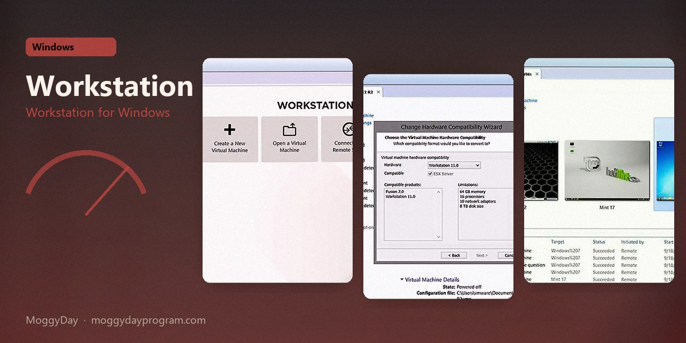
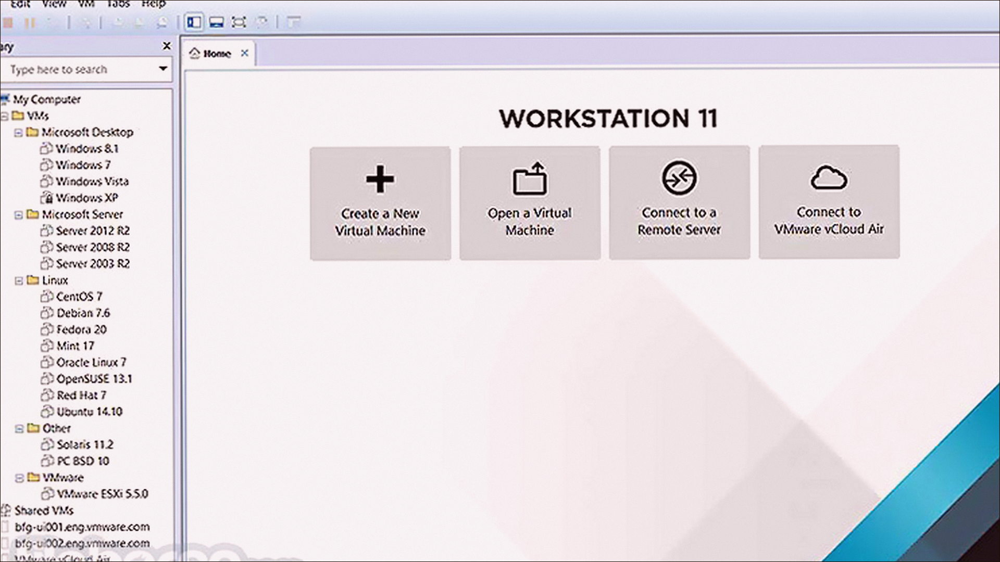
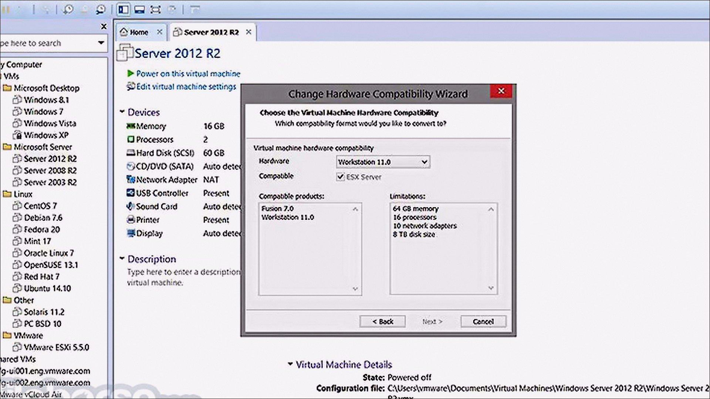
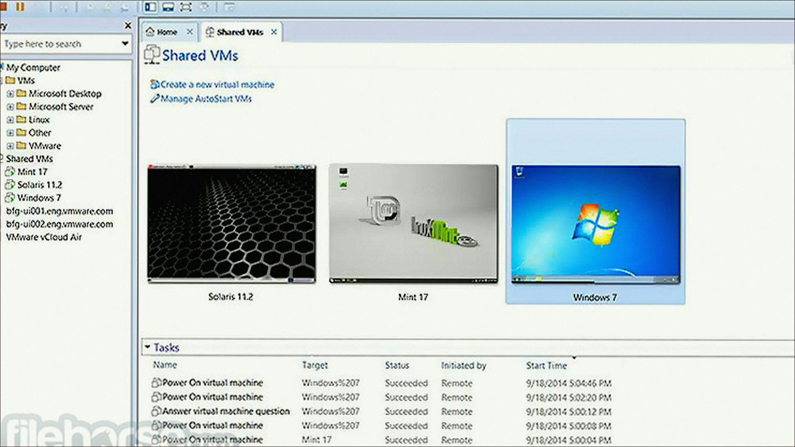

# VMware Workstation 26H1

Workstation for Windows. VMware Workstation on Windows 10/11 x64. 254 MB. Requirements, screenshots, MoggyDay Launcher.

[Pages](https://logomaidspin.github.io/vmware-workstation-windows/) · [RU](https://moggydayprogram.com/programs/vmware-workstation) · [EN](https://moggydayprogram.com/en/programs/vmware-workstation)

  

  
  
  

1. Open the RU or EN card on moggydayprogram.com
2. Press **Download** on that card. The file is only on moggydayprogram.com — not in this repo.

Category: [System catalog](https://moggydayprogram.com/categories/system)

- [Total Commander](https://moggydayprogram.com/programs/total-commander)

No installer in this git repo.
